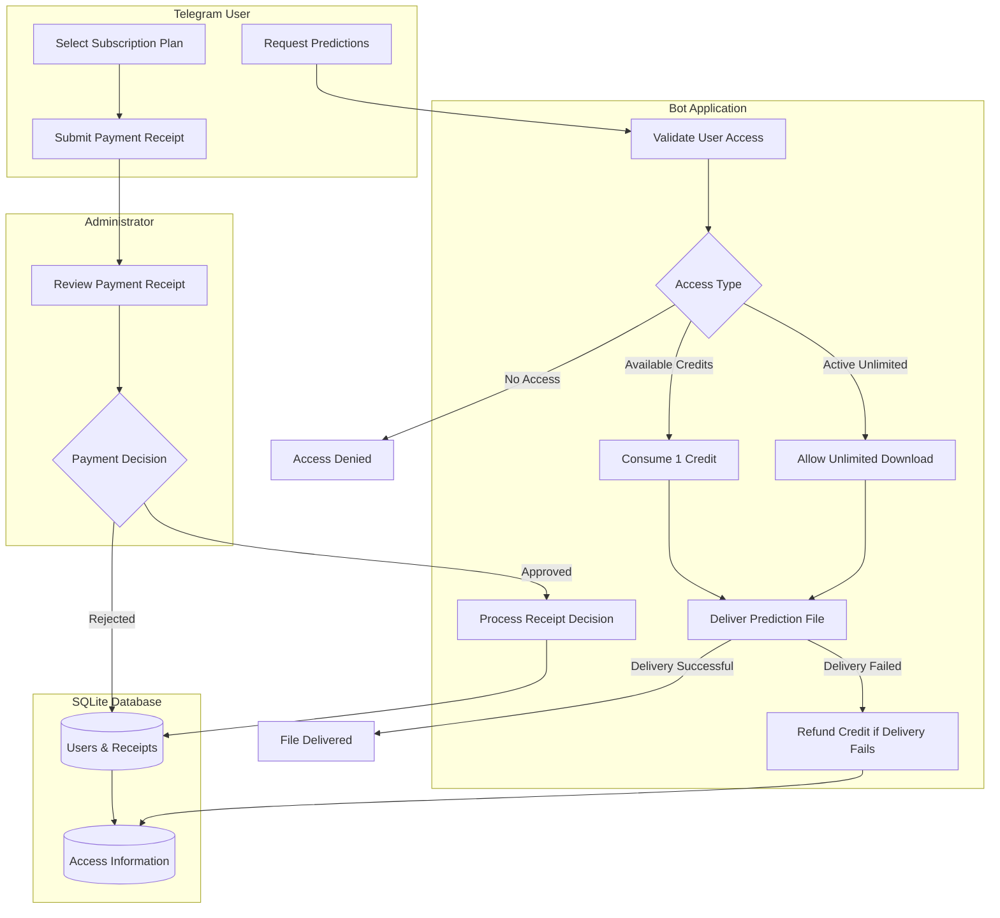
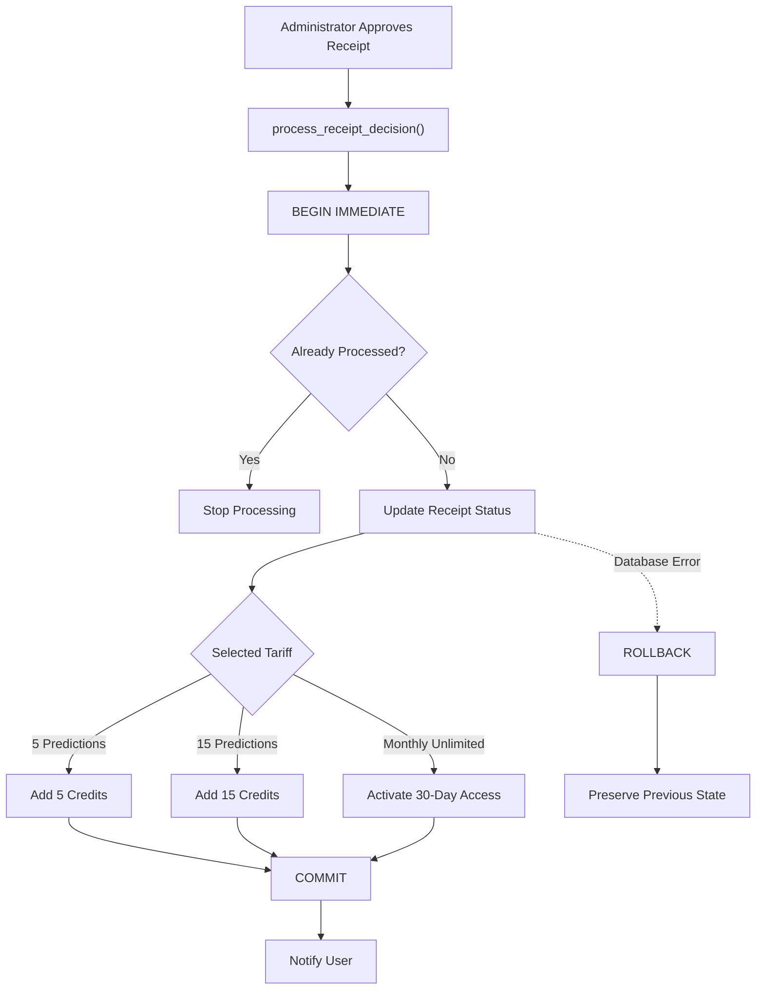

## Architecture

The application consists of three main components: Telegram interface, business logic, and persistent storage.

### Application Workflow

### Payment Processing

Receipt approval and access activation are handled within a single database transaction.

The transaction ensures that receipt status and access allocation remain consistent. A receipt cannot grant access more than once.
