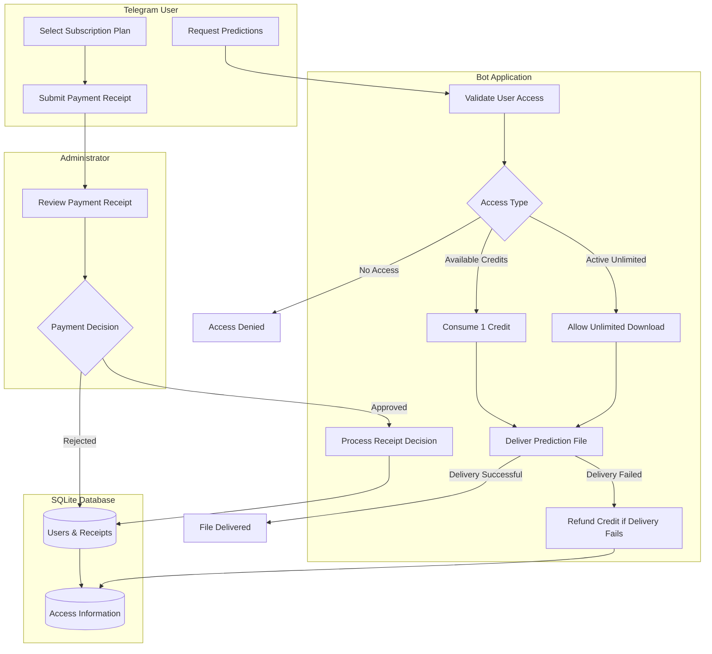
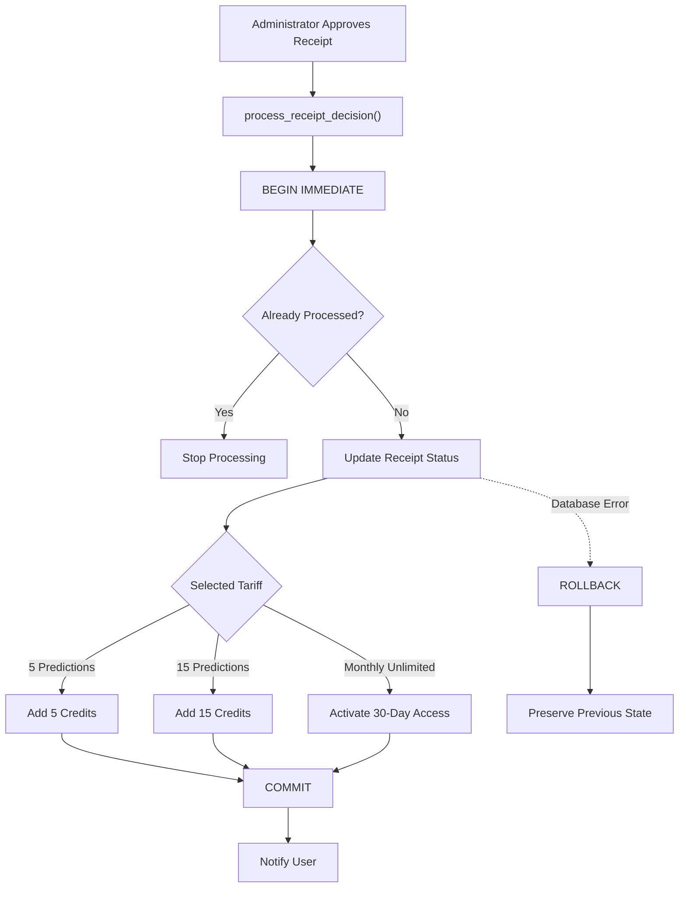

# NBA Subscription Bot

A Telegram bot for managing paid access to NBA match predictions. The application handles user registration, subscription plans, payment receipt review, access control, and CSV file delivery.

## Overview

The project provides a subscription-based distribution layer for NBA prediction data generated by an external pipeline.

Users interact with the bot through Telegram, select an access plan, submit a payment receipt, and receive prediction files after an administrator approves the payment.

The application is built with Python, Aiogram 3, and SQLite. It includes transactional access management, subscription expiration tracking, and automated database tests.

## Features

- **User management** — register users and store their subscription information.
- **Flexible access plans** — purchase prediction packages or time-limited unlimited access.
- **Manual payment verification** — users submit payment receipts for administrator review.
- **Administrative controls** — approve or reject receipts, manage access, and broadcast messages.
- **Access control** — validate user permissions before delivering prediction files.
- **Credit management** — accumulate purchased credits and consume them when requesting predictions.
- **Unlimited access** — grant access for a fixed period without consuming package credits.
- **Safe credit handling** — restore a credit if file delivery fails.
- **SQLite persistence** — store users, payment receipts, and access information.

## Subscription Plans

| Plan | Price | Access |
|---|---:|---|
| 5 Predictions | 500 RUB | 5 downloads, no expiration |
| 15 Predictions | 1,200 RUB | 15 downloads, no expiration |
| Monthly Unlimited | 2,500 RUB | Unlimited downloads for 30 days |

Package purchases add credits to the user's existing balance. Credits do not expire and remain available even if the user purchases unlimited access.

While unlimited access is active, downloads do not consume package credits. After unlimited access expires, any remaining credits can still be used.

Repeated unlimited purchases extend the current expiration date rather than replacing the remaining access period.


## Architecture

The application consists of three main components: Telegram interface, business logic, and persistent storage.

### Application Workflow



### Payment Processing

Receipt approval and access activation are handled within a single database transaction.



The transaction ensures that receipt status and access allocation remain consistent. A receipt cannot grant access more than once.

## Access Management

Access is managed through two mechanisms:

**Prediction credits**

- Credits are granted after an approved package purchase.
- Each successful prediction file delivery consumes one credit.
- Credit deduction is performed atomically in the database.
- If file delivery fails, the consumed credit is refunded.

**Unlimited access**

- Grants unlimited downloads for a defined period.
- Does not consume the user's package credits.
- Can be extended by purchasing another unlimited period.
- Expired unlimited access falls back to any remaining package credits.

Receipt processing and access activation are handled within a single SQLite transaction. This prevents a payment receipt from being processed more than once and keeps payment status consistent with granted access.

## Tech Stack

| Technology | Purpose |
|---|---|
| Python 3.11+ | Application runtime |
| Aiogram 3 | Asynchronous Telegram Bot API framework |
| SQLite | Persistent storage |
| asyncio | Asynchronous execution |
| python-dotenv | Environment configuration |
| unittest | Automated database tests |

## Project Structure

```text
nba-subscription-bot/
├── bot/
│   ├── __init__.py
│   ├── admin.py          # Administrative commands and receipt review
│   ├── config.py         # Application configuration
│   ├── database.py       # Database operations and access management
│   ├── handlers.py       # User-facing bot handlers
│   ├── keyboards.py      # Telegram keyboards
│   └── states.py         # FSM states
├── output/
│   └── .gitkeep          # Placeholder for prediction data
├── tests/
│   └── test_database.py  # SQLite and access-management tests
├── .env.example          # Environment variable template
├── .gitignore
├── main.py               # Application entry point
├── requirements.txt
└── README.md
```

## Installation

### 1. Clone the repository

```bash
git clone https://github.com/analytic-sperformance/nba-subscription-bot.git
cd nba-subscription-bot
```

### 2. Create and activate a virtual environment

**Windows PowerShell:**

```powershell
python -m venv .venv
.venv\Scripts\Activate.ps1
```

**Linux / macOS:**

```bash
python3 -m venv .venv
source .venv/bin/activate
```

### 3. Install dependencies

```bash
python -m pip install -r requirements.txt
```

### 4. Configure environment variables

Create a `.env` file in the project root using `.env.example` as a template.

| Variable | Description |
|---|---|
| `BOT_TOKEN` | Telegram bot token |
| `ADMIN_ID` | Telegram ID of the administrator |
| `SUBSCRIPTION_DAYS` | Default subscription duration |
| `DB_PATH` | Path to the SQLite database |
| `PREDICTION_FILE` | Path to the CSV prediction file |

Example configuration:

```env
BOT_TOKEN=your_telegram_bot_token
ADMIN_ID=123456789
SUBSCRIPTION_DAYS=30
DB_PATH=subscribers.db
PREDICTION_FILE=output/Future_Matches_Predictions.csv
```

Never commit your actual `.env` file or expose your Telegram bot token.

### 5. Prepare prediction data

Place the prediction CSV file at the path specified by `PREDICTION_FILE`.

The default path is:

```text
output/Future_Matches_Predictions.csv
```

Prediction generation is handled externally and is not included in this repository.

### 6. Run the bot

```bash
python main.py
```

## Testing

The project includes automated tests for database operations and subscription access logic.

Run the test suite with:

```bash
python -m unittest discover -s tests -v
```

The tests use isolated temporary SQLite databases and do not modify the application's production database.

The test suite covers:

- Accumulation of purchased prediction credits.
- Receipt approval and rejection.
- Prevention of duplicate receipt processing.
- Unlimited access activation and extension.
- Credit consumption and refunds.
- Fallback to remaining credits after unlimited access expires.
- Credit preservation during unlimited access and subscription deactivation.
- Transaction rollback on failed credit allocation.
- Migration from the legacy database schema.

## Database Design

The application uses SQLite to persist user and payment information.

The main entities are:

**Users**
- Telegram user ID and username.
- Selected tariff.
- Remaining prediction credits.
- Unlimited access expiration date.
- Legacy subscription fields retained for backward compatibility.

**Receipts**
- Receipt ID and associated user ID.
- Telegram file reference.
- Selected tariff.
- Processing status.
- Submission timestamp.

Database operations are organized in `bot/database.py`. Critical payment and access updates use explicit transaction handling to maintain data consistency.

## Security and Configuration

- Bot credentials are loaded from environment variables.
- Local environment files are excluded from version control.
- SQLite database files are excluded from version control.
- Generated prediction files are excluded from version control.
- Administrative operations are restricted by Telegram user ID.

## Limitations

- Payment verification is manual; no payment gateway is integrated.
- Prediction generation and model training are outside the scope of this application.
- The bot distributes an existing CSV file rather than calculating predictions itself.
- FSM state is stored in memory and is lost when the application restarts.
- The project is a portfolio demonstration and has not been audited or hardened for production deployment.

## License

No license has been specified for this repository. All rights are reserved by default.