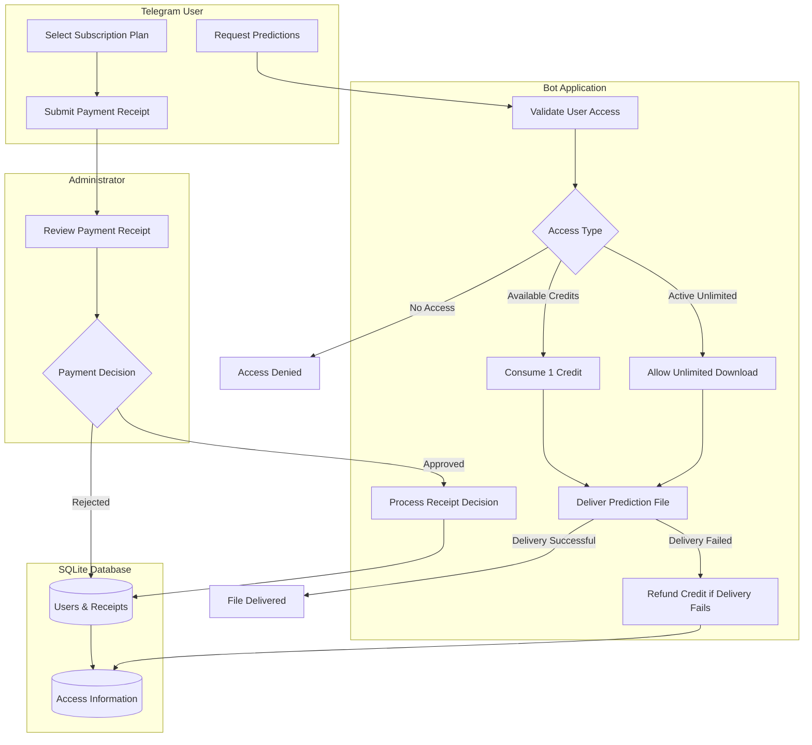
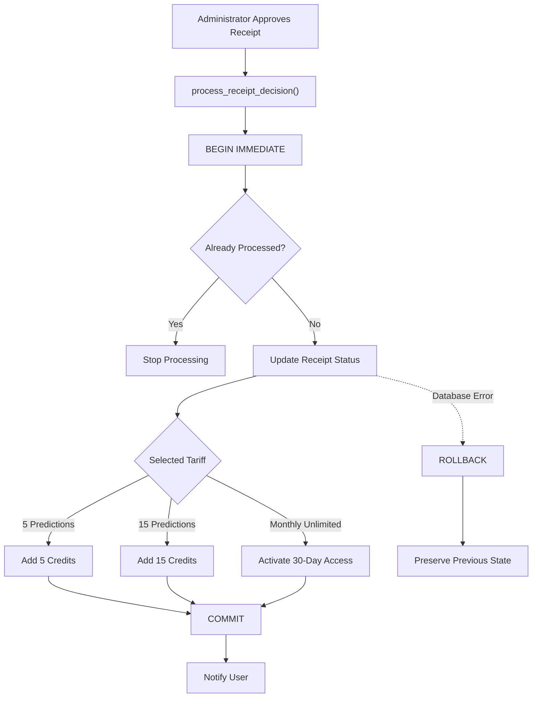

# NBA Subscription Bot

A Telegram bot that manages paid access to NBA prediction files. Users can purchase prediction packages or 30-day unlimited access, submit payment receipts, and download CSV files after manual approval by an administrator.

Prediction data is generated by an external pipeline. This project handles subscription management, payment verification, access control, and file delivery.

## Features

- **User management** — register users and store their access information.
- **Subscription plans** — purchase prediction packages or 30-day unlimited access.
- **Payment verification** — submit payment receipts for manual administrator review.
- **Administrative controls** — approve or reject receipts, manage user access, and broadcast messages.
- **Access control** — check user permissions before delivering prediction files.
- **Credit management** — accumulate purchased credits and deduct them when requesting predictions.
- **Unlimited access** — download prediction files without using package credits during an active subscription.
- **Credit refunds** — restore a deducted credit if file delivery fails.
- **SQLite storage** — persist user accounts, payment receipts, and access information.

## Subscription Plans

| Plan | Price | Access |
|---|---:|---|
| 5 Predictions | 500 RUB | 5 downloads, no expiration |
| 15 Predictions | 1,200 RUB | 15 downloads, no expiration |
| Monthly Unlimited | 2,500 RUB | Unlimited downloads for 30 days |

Package purchases add credits to the user's existing balance. Credits do not expire and remain available when the user purchases unlimited access.

While unlimited access is active, downloads do not consume package credits. After it expires, any remaining credits can still be used.

Repeated unlimited purchases extend the current expiration date rather than replacing the remaining access period.

## Architecture

The application consists of three main components: the Telegram interface, application logic, and SQLite storage.

### Application Workflow



### Payment Processing

Receipt approval and access allocation are handled in a single SQLite transaction.



The transaction ensures that receipt status and access allocation are updated together. Repeated processing of the same receipt cannot grant access more than once.

## Access Management

The bot uses two types of access.

**Prediction credits**

- Credits are added after an administrator approves a package purchase.
- One credit is deducted when a user requests a prediction file.
- Credit deduction is handled by the database layer.
- If file delivery fails, the deducted credit is refunded.

**Unlimited access**

- Provides unlimited downloads for a fixed period of 30 days.
- Does not consume package credits.
- Can be extended by purchasing another unlimited period.
- Falls back to remaining package credits after expiration.

## Tech Stack

| Technology | Purpose |
|---|---|
| Python 3.11+ | Application runtime |
| Aiogram 3 | Asynchronous Telegram Bot API framework |
| SQLite | Persistent storage |
| asyncio | Asynchronous execution |
| python-dotenv | Environment configuration |
| unittest | Automated testing |

## Project Structure

```text
nba-subscription-bot/
├── bot/
│   ├── __init__.py
│   ├── admin.py          # Administrative commands and receipt review
│   ├── config.py         # Application configuration
│   ├── database.py       # Database operations and access management
│   ├── handlers.py       # User-facing bot handlers
│   ├── keyboards.py      # Telegram keyboards
│   └── states.py         # FSM states
├── output/
│   └── .gitkeep          # Placeholder for prediction data
├── tests/
│   └── test_database.py  # Database and access-management tests
├── .env.example          # Environment variable template
├── .gitignore
├── main.py               # Application entry point
├── requirements.txt
└── README.md
```

## Installation

### 1. Clone the repository

```bash
git clone https://github.com/analytic-sperformance/nba-subscription-bot.git
cd nba-subscription-bot
```

### 2. Create and activate a virtual environment

**Windows PowerShell:**

```powershell
python -m venv .venv
.venv\Scripts\Activate.ps1
```

**Linux / macOS:**

```bash
python3 -m venv .venv
source .venv/bin/activate
```

### 3. Install dependencies

```bash
python -m pip install -r requirements.txt
```

### 4. Configure environment variables

Create a `.env` file in the project root using `.env.example` as a template.

| Variable | Description |
|---|---|
| `BOT_TOKEN` | Telegram bot token |
| `ADMIN_ID` | Telegram ID of the administrator |
| `SUBSCRIPTION_DAYS` | Default subscription duration |
| `DB_PATH` | Path to the SQLite database |
| `PREDICTION_FILE` | Path to the CSV prediction file |

Example configuration:

```env
BOT_TOKEN=your_telegram_bot_token
ADMIN_ID=123456789
SUBSCRIPTION_DAYS=30
DB_PATH=subscribers.db
PREDICTION_FILE=output/Future_Matches_Predictions.csv
```

Keep your actual `.env` file private and do not commit it to version control.

### 5. Prepare prediction data

Place the prediction CSV file at the path specified by `PREDICTION_FILE`.

The default path is:

```text
output/Future_Matches_Predictions.csv
```

Prediction generation is handled by an external pipeline and is not included in this repository.

### 6. Run the bot

```bash
python main.py
```

## Testing

The project includes automated tests for database operations and access management.

Run the test suite with:

```bash
python -m unittest discover -s tests -v
```

Tests use isolated temporary SQLite databases and do not modify the application's production database.

The test suite covers:

- Accumulation of purchased prediction credits.
- Receipt approval and rejection.
- Prevention of duplicate receipt processing.
- Unlimited access activation and extension.
- Credit consumption and refunds.
- Fallback to remaining credits after unlimited access expires.
- Credit preservation during unlimited access and subscription deactivation.
- Transaction rollback when credit allocation fails.
- Migration from the legacy database schema.

## Database Design

The application uses SQLite to store user and payment information.

The database contains two main tables:

**Users**

- Telegram user ID and username.
- Selected tariff.
- Remaining prediction credits.
- Unlimited access expiration date.
- Legacy subscription fields retained for backward compatibility.

**Receipts**

- Receipt ID and associated user ID.
- Telegram file reference.
- Selected tariff.
- Processing status.
- Submission timestamp.

Database operations are implemented in `bot/database.py`.

## Security and Configuration

- Bot credentials are loaded from environment variables.
- Local environment files are excluded from version control.
- SQLite database files are excluded from version control.
- Generated prediction files are excluded from version control.
- Administrative operations are restricted by Telegram user ID.

## Limitations

- Payments are verified manually; no payment gateway is integrated.
- Prediction generation and model training are outside the scope of this application.
- The bot distributes existing CSV files rather than generating predictions.
- FSM state is stored in memory and is lost when the application restarts.
- The repository is intended as a portfolio project and has not been audited or hardened for production deployment.

## License

No license has been specified for this repository. All rights are reserved by default.